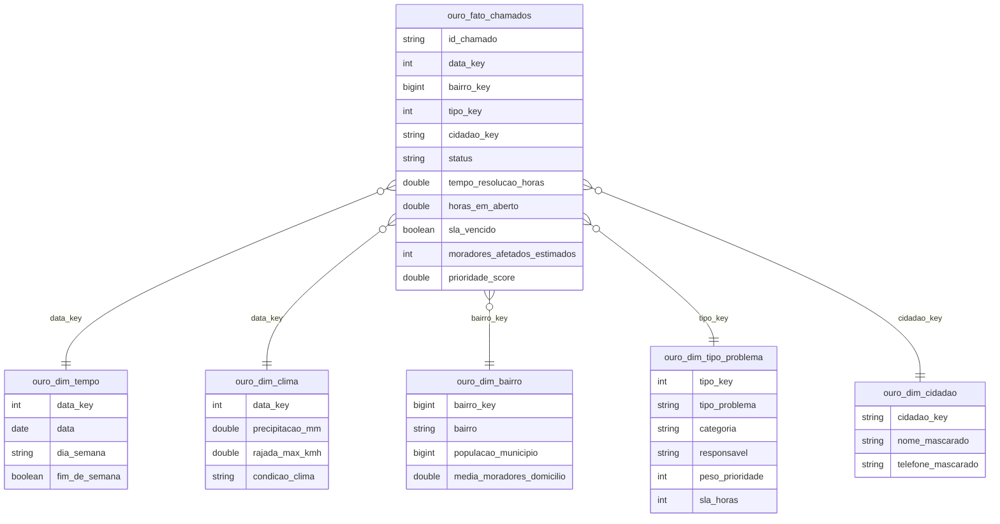

# Akona Energy · Componente de Dados do MVP

> Global Solution FIAP 2026.2 · CitizenTech · **Big Data Architecture & Data Integration** · Engenharia de Software, 4º ano

**O produto em uma frase:** o Akona Energy é um webapp em que moradores de Osasco (SP) reportam problemas de
iluminação pública e de energia (poste apagado, lâmpada piscando, fio caído e queda de energia) para que a
prefeitura e a distribuidora acompanhem, priorizem e resolvam os chamados.

Este repositório contém **só o componente de Dados**: o pipeline que coleta dados reais e simulados no **Airflow 3**,
envia os arquivos ao **Databricks Free Edition** e executa lá as camadas **Bronze, Prata e Ouro**, tudo orquestrado
pelo Airflow, até entregar à tela do MVP o que a gestão vê.

## Integrantes

| Nome completo | RM |
|---|---|
| Guilherme Dal Posolo Matheus | 98694 |
| Lucas Laia Manentti | 97709 |
| João Lucas Yudi | 98458 |
| Guilherme Vargas | 98278 |
| Ryan Perez Pacheco | 98782 |

## Perguntas que o MVP responde

1. Quais bairros têm mais chamados abertos, e de que tipo?
2. Qual o tempo médio de resolução por tipo de problema e por bairro?
3. Quais chamados devem ser priorizados (fio caído e queda de energia primeiro)?
4. Chuva e vento aumentam os chamados de queda de energia?
5. **Impacto:** quantos moradores são afetados por problemas não resolvidos?

## Arquitetura


**Uma DAG por processo** no Airflow 3 (Docker, no PC da equipe), orquestradas pela **`trigger-master`**:

```
trigger-master (todo dia às 06:00, ou Trigger manual; as fontes rodam no modo incremental)
 ├─ akona_clima ──┐                (em paralelo)
 ├─ akona_ibge ───┼─→ akona_ouro ─→ akona_consultas
 └─ akona_chamados┘   (chamados espera o clima: o simulador usa a chuva do dia)
```

| DAG | Processo |
|---|---|
| `akona_clima`, `akona_ibge`, `akona_chamados` | **uma por fonte, do começo até a Prata:** `coletar_api` → `conferir_chegada` → `enviar_ao_volume` → `bronze` → `prata` (com `preparar_databricks` e `publicar_notebooks` em paralelo) |
| `akona_ouro` | todas as tabelas da Ouro, **uma tarefa por tabela**: as 5 dimensões em paralelo → fato → tabela do MVP |
| `akona_consultas` | as 5 consultas de análise do MVP e a verificação de LGPD |
| `trigger-master` | dispara todas as outras na ordem certa, esperando cada uma terminar |

- **Tudo roda no Databricks** (serverless): cada tarefa de camada publica o notebook do repositório no workspace
  (`/Shared/akona`), dispara a execução (Jobs API), espera terminar e falha se o notebook falhar. O log da tarefa traz
  o link da execução. Ninguém cola código à mão: o que roda é sempre o que está no Git.
- **Envio ao Volume** (Files API): idempotente, porque arquivos que já estão lá são pulados.
- **Coleta idempotente:** dia que já tem arquivo em `chegada/` não chama a API de novo.
- **Modos de execução** (parâmetro `modo` das DAGs de fonte): `incremental`, `data_especifica` ou `full`. Veja a seção
  [Modos de execução](#modos-de-execução).
- **Orientado a configuração:** URLs, parâmetros, dependências e notebooks de cada fonte ficam em `config/`. Uma fonte
  nova é um cadastro novo, sem mexer no código principal. Veja [docs/como_adicionar_fonte.md](docs/como_adicionar_fonte.md).

| Camada | O que acontece |
|---|---|
| **Bronze** | Auto Loader lê só os arquivos novos do Volume e nunca duplica |
| **Prata** | tipos, nulos e inválidos tratados, 4 regras de qualidade nos chamados (mais 4 em clima e IBGE) e `MERGE` pela chave |
| **Ouro** | modelo estrela (1 fato + 5 dimensões), dados pessoais protegidos (hash e máscara) e a tabela-contrato do MVP |
| **MVP** | painel AI/BI do Databricks que lê somente `ouro_mvp_painel_chamados` |

**Lotes:** a carga inicial foi feita em dois lotes de dias de coleta diferentes (**lote 1** = outubro, **lote 2** =
novembro) e uma **reexecução** do mesmo período, que não envia nem insere nada. Depois disso, cada coleta diária vira
um lote automático (`diario_AAAA-MM-DD`).

## Modos de execução

Cada DAG de fonte (`akona_clima`, `akona_ibge`, `akona_chamados`) tem o parâmetro **`modo`**, escolhido na tela de
**Trigger** do Airflow:

| `modo` | Período processado | Quando usar |
|---|---|---|
| `incremental` (padrão) | só o **dia anterior** | todo dia: é o que a `trigger-master` dispara às 06:00 |
| `data_especifica` | de `de` até `ate` (`ate` vazio = só o dia `de`) | um dia que não rodou (PC desligado, API fora do ar) ou uma carga por lotes |
| `full` | de **01/10/2026** (`inicio_dados` em `config/projeto.yaml`) até ontem | conferência geral: garante que **nenhum dia está faltando** |

**Em qualquer modo, nada é duplicado nem apagado:**
- a coleta pula os dias que já têm arquivo;
- o envio pula os arquivos que já estão no Volume;
- a Bronze (Auto Loader) só carrega arquivos novos;
- a Prata faz MERGE pela chave.

Por isso o `full` é seguro: ele **só preenche** os dias que faltarem. O log da tarefa `coletar_api` mostra o resultado,
por exemplo "1 dia(s) faltando foram coletados: ['2026-11-18']" ou "nenhum dia faltando (49 dia(s) já coletados)".

**Por que o full começa em 01/10/2026:** não existe um "full de verdade" (toda a história) neste projeto:
- a operação do Akona (os chamados) começa em 01/10/2026, então antes disso não há chamados;
- a API de clima usada (`/v1/forecast` do Open-Meteo) guarda só os últimos ~3 meses;
- o IBGE é dado de referência (Censo 2022), igual em todos os dias.

O full é, portanto, **todo o histórico do projeto**: do primeiro dia de dados até ontem. A data fica em
`config/projeto.yaml` e pode ser mudada sem mexer no código.

As DAGs `akona_ouro` e `akona_consultas` não têm modo porque **sempre recriam tudo** com o que existe na Prata.
A `trigger-master` também não tem: ela só orquestra o dia a dia (modo incremental).

## Fontes de dados

| Fonte | Origem | Tipo | Formato | Frequência de coleta | Arquivo em `chegada/` |
|---|---|---|---|---|---|
| Chamados dos moradores | API do webapp Akona, **simulada** por [`include/akona/simulador_chamados.py`](include/akona/simulador_chamados.py) (exige token) | interna, simulada | JSON Lines (1 chamado por linha) | diária, 06:00 (dia anterior) | `chamados/chamados_AAAA-MM-DD.json` |
| Clima de Osasco | [Open-Meteo](https://open-meteo.com/) `api.open-meteo.com/v1/forecast`: chuva, vento, rajada, temperatura e código do tempo, de hora em hora | **externa**, API pública sem chave | JSON | diária, 06:00 (dia anterior) | `clima/clima_AAAA-MM-DD.json` |
| Município e Censo 2022 | [API do IBGE](https://servicodados.ibge.gov.br/api/docs): localidades + agregados 4714 (população, área, densidade) e 4712 (domicílios e média de moradores) | **externa**, API pública sem chave | JSON | diária (dado de referência; o MERGE mantém 1 versão) | `ibge/ibge_AAAA-MM-DD.json` |

- **Por que simular os chamados:** o webapp ainda não existe. O simulador é determinístico (o mesmo dia gera sempre
  o mesmo arquivo), traz chamados novos **e** mudanças de status de chamados antigos, usa o **clima real** do dia como
  fator de risco para a rede elétrica e injeta erros de propósito para exercitar a Prata.
- **Por que não a ANEEL:** o dataset de interrupções só é publicado como arquivos anuais nacionais (ZIP/Parquet de
  265 a 424 MB, atualização mensal, sem API de consulta). Baixá-lo todo dia não traz dado do dia. Fica como trabalho futuro.
- Amostras de cada fonte estão em [`amostras/`](amostras/).

## Estrutura do repositório

```
config/                          CADASTROS (o que muda de uma fonte/tabela para outra)
  projeto.yaml                   município, coordenadas, nomes no Databricks
  fontes/clima.yaml              uma fonte por arquivo: API, parâmetros, dependências, notebook da Prata
  fontes/ibge.yaml
  fontes/chamados.yaml
  ouro.yaml                      tabelas da Ouro e de quem cada uma depende
  consultas.yaml                 notebooks de análise
dags/                            SÓ definição de DAG (arquivos curtos)
  trigger_master.py              trigger-master: orquestra todas as outras
  akona_clima.py                 DAG da fonte clima   (criar_dag_fonte("clima"))
  akona_ibge.py                  DAG da fonte IBGE    (criar_dag_fonte("ibge"))
  akona_chamados.py              DAG da fonte chamados (criar_dag_fonte("chamados"))
  akona_ouro.py                  DAG da Ouro (uma tarefa por tabela de config/ouro.yaml)
  akona_consultas.py             DAG das consultas de análise
include/akona/                   CÓDIGO reutilizável (nenhum DAG aqui)
  apis.py                        TODAS as chamadas de API (extrator http genérico + funções específicas)
  dag_fonte.py                   padrão de DAG por fonte: API → chegada → Volume → Bronze → Prata
  tarefas.py                     tarefas usadas pelas DAGs (coletar, conferir, enviar, rodar notebook...)
  configuracao.py                leitura e validação dos YAML de config/
  chegada.py                     padrão de nomes e conferência dos arquivos da pasta chegada/
  databricks_api.py              cliente da API REST do Databricks (Unity Catalog, Files, Secrets, Workspace, Jobs)
  simulador_chamados.py          API de chamados simulada (só biblioteca padrão do Python)
  notificacao.py                 notificações (log da tarefa + webhook opcional do Discord)
databricks/                      notebooks executados no Databricks pelas DAGs
  comum/funcoes.py               funções compartilhadas por Bronze e Prata (%run): normalização, regras, MERGE
  bronze/bronze_autoloader.py    Bronze GENÉRICA (parâmetro fonte): Auto Loader + contagens antes e depois
  prata/prata_<fonte>.py         uma Prata por fonte (+ _modelo_prata.py para fontes novas)
  ouro/<tabela>.sql              uma tabela da Ouro por arquivo (dimensões, fato e tabela do MVP)
  consultas/consultas_mvp.sql    as 5 consultas do MVP
  consultas/verificacao_lgpd.sql prova de que a Ouro não tem dado pessoal em claro
amostras/                        um arquivo de cada fonte (dados pessoais 100% fictícios)
airflow/variables.example.json   modelo das Variables (sem segredo)
docs/
  como_adicionar_fonte.md        o padrão para incluir uma fonte/tabela nova
  dashboard_mvp.md               roteiro da tela do MVP (painel AI/BI)
  relatorio_modelo.md            modelo do relatório em PDF, na ordem pedida
  img/arquitetura.svg / .png     diagrama do fluxo de dados
docker-compose.yml               Airflow 3.3.2 (standalone) + Postgres
```

MongoDB não foi usado (é opcional no enunciado).

## Como reproduzir o pipeline

**Pré-requisitos:** [Docker Desktop](https://www.docker.com/products/docker-desktop/) e uma conta no
[Databricks Free Edition](https://www.databricks.com/learn/free-edition) com um **token de acesso pessoal**
(Settings → Developer → Access tokens). Não é preciso criar nada no Databricks: o Airflow cria tudo.

```powershell
# na pasta do projeto
docker compose up -d
```

1. Aguarde 1 a 2 minutos e abra **http://127.0.0.1:8080**. Não há tela de login: é um ambiente local de estudo.
2. Crie as Variables em **Admin → Variables → Add**. Chaves e tokens **nunca** ficam no código nem no repositório.

   | Key | Value |
   |---|---|
   | `akona_api_token` | **obrigatória**. Token da API de chamados (simulada): qualquer valor aleatório, ex.: saída de `python -c "import secrets; print(secrets.token_hex(16))"` |
   | `akona_databricks_host` | **obrigatória**. URL do workspace, ex.: `https://dbc-xxxxxxxx-xxxx.cloud.databricks.com` |
   | `akona_databricks_token` | **obrigatória**. Token de acesso pessoal do Databricks (fica mascarado no Airflow) |
   | `akona_execucao_diaria` | `true` para a `trigger-master` rodar sozinha todo dia às 06:00 (`false` desliga só a agendada; o Trigger manual sempre roda) |
   | `akona_webhook_secret` | opcional. URL de um webhook do Discord para receber as notificações |

   O que não é segredo (município, coordenadas, nomes no Databricks) fica em [`config/projeto.yaml`](config/projeto.yaml).

3. Ative (unpause) as 6 DAGs: `trigger-master`, `akona_clima`, `akona_ibge`, `akona_chamados`, `akona_ouro` e
   `akona_consultas`. As DAGs filhas precisam estar ativas para rodar quando a `trigger-master` as disparar.
4. **Carga inicial em lotes:** para cada lote, dispare as DAGs de fonte com **Trigger → com configuração**, usando
   `modo = data_especifica`. Comece por `akona_clima` e `akona_ibge`, depois `akona_chamados`, que usa o clima. Em seguida
   dispare `akona_ouro` e depois `akona_consultas`. Espere cada lote terminar antes do próximo:

   | Lote | `de` | `ate` | `lote` | Resultado esperado |
   |---|---|---|---|---|
   | 1 | 2026-10-01 | 2026-10-31 | `lote_1` | coleta e envia outubro; cria Bronze e Prata |
   | 2 | 2026-11-01 | 2026-11-17 | `lote_2` | envia só novembro; a Bronze cresce e o MERGE atualiza status |
   | 3 | 2026-10-01 | 2026-11-17 | `reexecucao` | 0 arquivos enviados e 0 linhas novas na Bronze (prova de idempotência) |

   Para uma carga de uma vez só, use `modo = full` nas três fontes.

5. A partir daí, a `trigger-master` roda todo dia às 06:00 (com `akona_execucao_diaria` = `true`) e dispara tudo no modo
   incremental.
6. **Tela do MVP:** siga [`docs/dashboard_mvp.md`](docs/dashboard_mvp.md).
7. Para parar: `docker compose stop`. O histórico fica no Postgres, num volume do Docker.

## Camadas

### Bronze: incremental e sem duplicação
- Auto Loader (`cloudFiles`, JSON, `trigger(availableNow=True)`) com schema e checkpoint em `chegada/_controle/`.
- Colunas de linhagem: `arquivo_origem` (`_metadata.file_path`) e `carregado_em`.
- `controle_cargas_bronze` registra, a cada execução, o lote e as linhas e arquivos **antes e depois**.

### Prata: tratamento, regras de qualidade e MERGE

| Tabela | Chave do MERGE | Tratamentos |
|---|---|---|
| `prata_chamados` | `id_chamado` (atualiza só se `atualizado_em` for mais recente) | normaliza tipo, status e bairro; aceita data em 2 formatos; `try_cast` para números; domicílios nulos recebem a mediana do tipo; canal nulo vira `nao_informado`; deduplicação antes do MERGE |
| `prata_clima_horario` | `cod_municipio` + `data_hora` | `posexplode` das listas paralelas do Open-Meteo (1 linha por hora) |
| `prata_ibge_indicadores` | `cod_municipio` + `indicador_id` + `ano` | achata variável → resultados → séries → `{ano: valor}` |

| Regra | Tabela | Barra o registro quando |
|---|---|---|
| R1_obrigatorios | chamados | id, tipo ou data de abertura nulo ou ilegível |
| R2_dominio | chamados | tipo fora dos 4 aceitos ou status fora de aberto, em_andamento e resolvido |
| R3_localizacao | chamados | bairro não é de Osasco ou coordenadas fora do município (ex.: GPS 0,0) |
| R4_datas_coerentes | chamados | resolução anterior à abertura |
| C1, C2, C3 | clima | hora ilegível; chuva fora de 0 a 200 mm/h; rajada fora de 0 a 250 km/h |
| I1 | IBGE | valor não numérico ou menor ou igual a zero |

Os barrados vão para `prata_chamados_rejeitados` (com o motivo) e o total por regra fica em `controle_qualidade`.

### Ouro: modelo estrela



| Pergunta do MVP | Consulta em `databricks/consultas/consultas_mvp.sql` |
|---|---|
| 1. Bairros com mais chamados abertos e de que tipo | ranking por bairro com `COUNT_IF` por tipo |
| 2. Tempo médio de resolução por tipo e bairro | média, mediana e % dentro do SLA com `GROUPING SETS` |
| 3. Quais chamados priorizar | fila ordenada pelo `prioridade_score` |
| 4. Chuva e vento × quedas de energia | média por condição do tempo + `corr()` |
| 5. **Impacto:** moradores afetados por problemas não resolvidos | soma estimada com `ROLLUP` e % da população (IBGE) |

## LGPD

- **Na Ouro não existe dado pessoal em claro.** O CPF vira `sha2(salt + cpf, 256)` (pseudonimização). O *salt* fica no
  **Databricks Secrets** (escopo `akona`, chave `salt_lgpd`): é gerado aleatoriamente pelo Airflow na primeira carga,
  ninguém vê o valor e ele nunca vai para o repositório. Sem salt, daria para descobrir o CPF testando os cerca de 10⁹
  CPFs possíveis.
- Nome e telefone ficam **mascarados** (`M**** S****`, `(11) *****-4321`). E-mail e número da casa **não entram** na
  Ouro e as coordenadas são arredondadas para 3 casas decimais (cerca de 100 m).
- A Prata guarda os dados pessoais (fictícios) para tratamento e é de acesso restrito à equipe de dados.
- **Todos os dados pessoais do projeto são fictícios:** o CPF é gerado com dígito verificador propositalmente inválido
  (nunca coincide com um CPF real) e os e-mails usam o domínio reservado `example.com`.

## Contrato com o produto (o que o MVP consome e mostra)

O MVP lê **uma única tabela**: `workspace.akona.ouro_mvp_painel_chamados`, atualizada a cada carga.

| Coluna | Na tela do MVP |
|---|---|
| `status`, `bairro`, `tipo_problema`, `categoria` | filtros e gráfico de não resolvidos por bairro e tipo |
| `moradores_afetados_estimados` | indicador "Moradores afetados" |
| `sla_vencido`, `tempo_resolucao_horas` | indicadores "% com SLA vencido" e "Tempo médio de resolução" |
| `posicao_fila`, `prioridade_score`, `horas_em_aberto` | tabela "Fila de prioridade" |
| `solicitante`, `contato` | fila, sempre mascarados |
| `data_abertura`, `chuva_no_dia_mm`, `condicao_clima` | gráfico "Rede elétrica × chuva por dia" |

## Requisitos do enunciado → onde estão

| Req. | O que pede | Onde |
|---|---|---|
| 01 | 2+ fontes, 1 externa | Open-Meteo e IBGE (externas) + chamados simulados |
| 02 | DAG agendado gravando em `chegada/` com data no nome | `trigger-master` (`0 6 * * *`) dispara `akona_<fonte>`, que grava `chegada/<fonte>/<fonte>_AAAA-MM-DD.json` |
| 03 | 2 tarefas em paralelo, conferência, chaves em Variables | `coletar_clima` ∥ `coletar_ibge`, `conferir_chegada`, tokens em Variables |
| 04 | 2+ lotes de dias diferentes no Volume | tarefa `enviar_ao_volume` de cada DAG de fonte: lote 1 (outubro), lote 2 (novembro) e cargas diárias |
| 05 | Bronze incremental sem duplicar | `databricks/bronze/bronze_autoloader.py` (genérico) + `controle_cargas_bronze` |
| 06 | Prata: tipos, nulos, MERGE, 3+ regras com contagem | `databricks/prata/prata_<fonte>.py` + `databricks/comum/funcoes.py` + `controle_qualidade` |
| 07 | Ouro: 1 fato, 2+ dimensões, 5 consultas (1 de impacto) | `databricks/ouro/*.sql` (DAG `akona_ouro`) + `databricks/consultas/consultas_mvp.sql` (DAG `akona_consultas`) |
| 08 | LGPD na Ouro + tabela e tela do MVP | `ouro_dim_cidadao`, `ouro_mvp_painel_chamados`, `docs/dashboard_mvp.md` |
| 09 | README com integrantes, arquitetura e passo a passo | este arquivo |

## Problemas comuns

- **Abrir a interface:** use `http://127.0.0.1:8080`. Em algumas máquinas `localhost` tenta IPv6 e não responde.
- **`CERTIFICATE_VERIFY_FAILED` nas coletas:** um antivírus que inspeciona HTTPS (ex.: Norton Web/Mail Shield) está
  trocando o certificado. Gere um pacote com as autoridades confiáveis do Windows e aponte o container para ele:
  ```powershell
  New-Item -ItemType Directory -Force certs | Out-Null
  Get-ChildItem Cert:\LocalMachine\Root, Cert:\CurrentUser\Root | ForEach-Object { "-----BEGIN CERTIFICATE-----`n" + [Convert]::ToBase64String($_.RawData, 'InsertLineBreaks') + "`n-----END CERTIFICATE-----" } | Set-Content -Encoding ascii certs\ca-bundle.pem
  Set-Content -Encoding ascii .env "AKONA_CA_BUNDLE=/opt/airflow/certs/ca-bundle.pem"
  docker compose up -d
  ```
  Depois, em **Grid**, selecione as tarefas que falharam e clique em **Clear**. (`certs/` e `.env` estão no `.gitignore`.)
- **Uma camada falhou (bronze, prata, uma tabela da Ouro...):** o log da tarefa traz o erro do notebook e o link da execução no
  Databricks (Workflows → Job runs). Corrija o notebook em `databricks/`, e na próxima execução o Airflow publica a
  versão nova.
- **DAG não aparece:** `docker compose exec airflow airflow dags list-import-errors`.
- **`simular_chamados` falha com "Crie a Variable":** falta a Variable `akona_api_token`.
