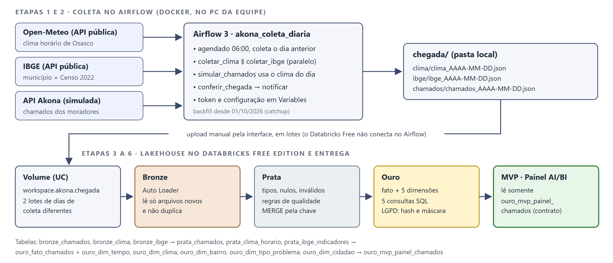
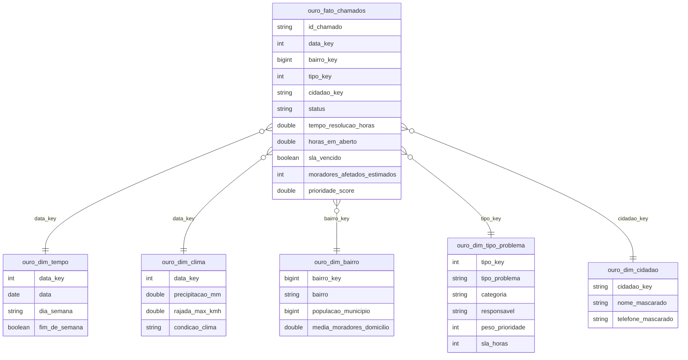

# Akona Energy · Componente de Dados do MVP

> Global Solution FIAP 2026.2 · CitizenTech · **Big Data Architecture & Data Integration** · Engenharia de Software, 4º ano

**O produto em uma frase:** o Akona Energy é um webapp em que moradores de Osasco (SP) reportam problemas de
iluminação pública e de energia (poste apagado, lâmpada piscando, fio caído e queda de energia) para que a
prefeitura e a distribuidora acompanhem, priorizem e resolvam os chamados.

Este repositório contém **só o componente de Dados**: o pipeline que coleta dados reais e simulados no **Airflow 3**,
trata em camadas **Bronze, Prata e Ouro** no **Databricks Free Edition** e entrega à tela do MVP o que a gestão vê.

## Integrantes

| Nome completo | RM |
|---|---|
| _preencher_ | _preencher_ |
| _preencher_ | _preencher_ |
| _preencher_ | _preencher_ |

## Perguntas que o MVP responde

1. Quais bairros têm mais chamados abertos, e de que tipo?
2. Qual o tempo médio de resolução por tipo de problema e por bairro?
3. Quais chamados devem ser priorizados (fio caído e queda de energia primeiro)?
4. Chuva e vento aumentam os chamados de queda de energia?
5. **Impacto:** quantos moradores são afetados por problemas não resolvidos?

## Arquitetura



1. **Airflow 3** (Docker, no PC da equipe) roda todo dia às 06:00 e coleta o **dia anterior** de cada fonte,
   gravando um arquivo por fonte e por dia na pasta `chegada/`.
2. O Databricks Free Edition não se conecta ao Airflow, então os arquivos sobem **pela interface** para o Volume
   `workspace.akona.chegada`, **em lotes** (lote 1 = outubro, lote 2 = novembro).
3. **Bronze** (Auto Loader): lê só os arquivos novos e nunca duplica.
4. **Prata**: tipos, nulos e inválidos tratados, 4 regras de qualidade nos chamados (mais 4 em clima e IBGE) e `MERGE` pela chave.
5. **Ouro**: modelo estrela (1 fato + 5 dimensões), dados pessoais protegidos (hash e máscara) e a tabela-contrato do MVP.
6. **MVP**: painel AI/BI do Databricks que lê somente `ouro_mvp_painel_chamados`.

## Fontes de dados

| Fonte | Origem | Tipo | Formato | Frequência de coleta | Arquivo em `chegada/` |
|---|---|---|---|---|---|
| Chamados dos moradores | API do webapp Akona, **simulada** por [`dags/akona/simulador_chamados.py`](dags/akona/simulador_chamados.py) (exige token) | interna, simulada | JSON Lines (1 chamado por linha) | diária, 06:00 (dia anterior) | `chamados/chamados_AAAA-MM-DD.json` |
| Clima de Osasco | [Open-Meteo](https://open-meteo.com/) `api.open-meteo.com/v1/forecast`: chuva, vento, rajada, temperatura e código do tempo, de hora em hora | **externa**, API pública sem chave | JSON | diária, 06:00 (dia anterior) | `clima/clima_AAAA-MM-DD.json` |
| Município e Censo 2022 | [API do IBGE](https://servicodados.ibge.gov.br/api/docs): localidades + agregados 4714 (população, área, densidade) e 4712 (domicílios e média de moradores) | **externa**, API pública sem chave | JSON | diária (dado de referência; o MERGE mantém 1 versão) | `ibge/ibge_AAAA-MM-DD.json` |

- **Por que simular os chamados:** o webapp ainda não existe. O simulador é determinístico (o mesmo dia gera sempre
  o mesmo arquivo), traz chamados novos **e** mudanças de status de chamados antigos, usa o **clima real** do dia como
  fator de risco para a rede elétrica e injeta erros de propósito para exercitar a Prata.
- **Por que não a ANEEL:** o dataset de interrupções só é publicado como arquivos anuais nacionais (ZIP/Parquet de
  265 a 424 MB, atualização mensal, sem API de consulta). Baixá-lo todo dia não traz dado do dia. Fica como trabalho futuro.
- Amostras de cada fonte estão em [`amostras/`](amostras/).

## Estrutura do repositório

```
dags/
  akona_coleta_diaria.py        DAG do Airflow (coleta, conferência e notificação)
  akona/simulador_chamados.py   API de chamados simulada (só biblioteca padrão do Python)
  .airflowignore                o pacote akona/ não é DAG
databricks/
  00_setup.py                   schema, Volume, pastas e tabelas de controle
  01_bronze_autoloader.py       Bronze com Auto Loader + contagens antes e depois
  02_prata.py                   tratamento, regras de qualidade e MERGE
  03_ouro.py                    modelo estrela, LGPD e tabela-contrato do MVP
  04_consultas_mvp.sql          as 5 consultas do MVP
amostras/                       um arquivo de cada fonte (dados pessoais 100% fictícios)
airflow/variables.example.json  modelo das Variables (sem segredo)
docs/
  dashboard_mvp.md              roteiro da tela do MVP (painel AI/BI)
  relatorio_modelo.md           modelo do relatório em PDF, na ordem pedida
  img/arquitetura.svg / .png    diagrama do fluxo de dados
docker-compose.yml              Airflow 3.3.2 em um container (standalone)
```

MongoDB não foi usado (é opcional no enunciado).

## Como reproduzir o pipeline

### 1. Coleta no Airflow 3

Pré-requisito: [Docker Desktop](https://www.docker.com/products/docker-desktop/) instalado e aberto.

```powershell
# na pasta do projeto
docker compose up -d
```

1. Aguarde 1 a 2 minutos e abra **http://localhost:8080**. Não há tela de login: é um ambiente local de estudo.
2. Crie as Variables em **Admin → Variables → Add** (chaves e tokens **nunca** ficam no código):

   | Key | Value |
   |---|---|
   | `akona_api_token` | **obrigatória**. Um token qualquer gerado por vocês, por exemplo a saída de `python -c "import secrets; print(secrets.token_hex(16))"` |
   | `akona_config` | opcional. O JSON de `akona_config` em [`airflow/variables.example.json`](airflow/variables.example.json) (coordenadas, código IBGE etc.) |
   | `akona_webhook_secret` | opcional. URL de um webhook do Discord para receber as notificações |

3. Em **Dags**, ative (unpause) o DAG **`akona_coleta_diaria`**. Com `catchup=True`, o Airflow executa um dia de
   cada vez desde 01/10/2026 (cerca de 20 minutos) e depois segue todo dia às 06:00.
4. Os arquivos aparecem em `chegada/clima`, `chegada/ibge` e `chegada/chamados`, com a data no nome.
5. Para parar sem perder o histórico: `docker compose stop` (evite `docker compose down`).

### 2. Lakehouse no Databricks Free Edition

1. Importe os arquivos de `databricks/` (**Workspace → Import**) ou clone o repositório em **Workspace → Create → Git folder**.
2. Rode **`00_setup`** (cria `workspace.akona`, o Volume `chegada` e as pastas `chamados/`, `clima/` e `ibge/`).
3. **Lote 1:** em **Catalog → workspace → akona → Volumes → chegada**, envie os arquivos de **outubro** de cada fonte
   para a pasta correspondente (**Upload to this volume**).
   - Rode **`01_bronze_autoloader`** com o widget `lote = lote_1`.
   - Rode **`02_prata`**.
   - Rode **`03_ouro`**, preenchendo o widget `salt_lgpd` com um segredo de 12 ou mais caracteres (não salve no repositório).
4. **Lote 2:** envie os arquivos de **novembro**.
   - Rode `01_bronze_autoloader` com `lote = lote_2`.
   - Rode `01_bronze_autoloader` **de novo** com `lote = reexecucao`. Deve dar 0 linhas novas: isso prova que não há duplicação.
   - Rode `02_prata`, `03_ouro` e **`04_consultas_mvp`**.
5. **Tela do MVP:** siga [`docs/dashboard_mvp.md`](docs/dashboard_mvp.md).

## Camadas

### Bronze: incremental e sem duplicação
- Auto Loader (`cloudFiles`, JSON, `trigger(availableNow=True)`) com schema e checkpoint em `chegada/_controle/`.
- Colunas de linhagem: `arquivo_origem` (`_metadata.file_path`) e `carregado_em`.
- `controle_cargas_bronze` registra, a cada execução, as linhas e arquivos **antes e depois**.

### Prata: tratamento, regras de qualidade e MERGE

| Tabela | Chave do MERGE | Tratamentos |
|---|---|---|
| `prata_chamados` | `id_chamado` (atualiza só se `atualizado_em` for mais recente) | normaliza tipo, status e bairro; aceita data em 2 formatos; `try_cast` para números; domicílios nulos recebem a mediana do tipo; canal nulo vira `nao_informado`; deduplicação antes do MERGE |
| `prata_clima_horario` | `cod_municipio` + `data_hora` | `posexplode` das listas paralelas do Open-Meteo (1 linha por hora) |
| `prata_ibge_indicadores` | `cod_municipio` + `indicador_id` + `ano` | achata variável → resultados → séries → `{ano: valor}` |

| Regra | Tabela | Barra o registro quando |
|---|---|---|
| R1_obrigatorios | chamados | id, tipo ou data de abertura nulo ou ilegível |
| R2_dominio | chamados | tipo fora dos 4 aceitos ou status fora de aberto, em_andamento e resolvido |
| R3_localizacao | chamados | bairro não é de Osasco ou coordenadas fora do município (ex.: GPS 0,0) |
| R4_datas_coerentes | chamados | resolução anterior à abertura |
| C1, C2, C3 | clima | hora ilegível; chuva fora de 0 a 200 mm/h; rajada fora de 0 a 250 km/h |
| I1 | IBGE | valor não numérico ou menor ou igual a zero |

Os barrados vão para `prata_chamados_rejeitados` (com o motivo) e o total por regra fica em `controle_qualidade`.

### Ouro: modelo estrela



| Pergunta do MVP | Consulta em `04_consultas_mvp.sql` |
|---|---|
| 1. Bairros com mais chamados abertos e de que tipo | ranking por bairro com `COUNT_IF` por tipo |
| 2. Tempo médio de resolução por tipo e bairro | média, mediana e % dentro do SLA com `GROUPING SETS` |
| 3. Quais chamados priorizar | fila ordenada pelo `prioridade_score` |
| 4. Chuva e vento × quedas de energia | média por condição do tempo + `corr()` |
| 5. **Impacto:** moradores afetados por problemas não resolvidos | soma estimada com `ROLLUP` e % da população (IBGE) |

## LGPD

- **Na Ouro não existe dado pessoal em claro.** O CPF vira `sha2(salt + cpf, 256)` (pseudonimização). O *salt* é um
  segredo digitado no widget do notebook e nunca vai para o repositório: sem ele, daria para descobrir o CPF testando
  os cerca de 10⁹ CPFs possíveis.
- Nome e telefone ficam **mascarados** (`M**** S****`, `(11) *****-4321`). E-mail e número da casa **não entram** na
  Ouro e as coordenadas são arredondadas para 3 casas decimais (cerca de 100 m).
- A Prata guarda os dados pessoais (fictícios) para tratamento e é de acesso restrito à equipe de dados.
- **Todos os dados pessoais do projeto são fictícios:** o CPF é gerado com dígito verificador propositalmente inválido
  (nunca coincide com um CPF real) e os e-mails usam o domínio reservado `example.com`.

## Contrato com o produto (o que o MVP consome e mostra)

O MVP lê **uma única tabela**: `workspace.akona.ouro_mvp_painel_chamados`, atualizada a cada carga.

| Coluna | Na tela do MVP |
|---|---|
| `status`, `bairro`, `tipo_problema`, `categoria` | filtros e gráfico de não resolvidos por bairro e tipo |
| `moradores_afetados_estimados` | indicador "Moradores afetados" |
| `sla_vencido`, `tempo_resolucao_horas` | indicadores "% com SLA vencido" e "Tempo médio de resolução" |
| `posicao_fila`, `prioridade_score`, `horas_em_aberto` | tabela "Fila de prioridade" |
| `solicitante`, `contato` | fila, sempre mascarados |
| `data_abertura`, `chuva_no_dia_mm`, `condicao_clima` | gráfico "Rede elétrica × chuva por dia" |

## Requisitos do enunciado → onde estão

| Req. | O que pede | Onde |
|---|---|---|
| 01 | 2+ fontes, 1 externa | Open-Meteo e IBGE (externas) + chamados simulados |
| 02 | DAG agendado gravando em `chegada/` com data no nome | `dags/akona_coleta_diaria.py` (`0 6 * * *`, catchup) |
| 03 | 2 tarefas em paralelo, conferência, chaves em Variables | `coletar_clima` ∥ `coletar_ibge`, `conferir_chegada`, `akona_api_token` |
| 04 | 2+ lotes de dias diferentes no Volume | lote 1 (outubro) e lote 2 (novembro) |
| 05 | Bronze incremental sem duplicar | `01_bronze_autoloader.py` + `controle_cargas_bronze` |
| 06 | Prata: tipos, nulos, MERGE, 3+ regras com contagem | `02_prata.py` + `controle_qualidade` |
| 07 | Ouro: 1 fato, 2+ dimensões, 5 consultas (1 de impacto) | `03_ouro.py` + `04_consultas_mvp.sql` |
| 08 | LGPD na Ouro + tabela e tela do MVP | `ouro_dim_cidadao`, `ouro_mvp_painel_chamados`, `docs/dashboard_mvp.md` |
| 09 | README com integrantes, arquitetura e passo a passo | este arquivo |

## Problemas comuns

- **`CERTIFICATE_VERIFY_FAILED` no log de `coletar_clima` ou `coletar_ibge`:** um antivírus que inspeciona HTTPS
  (ex.: Norton Web/Mail Shield) está trocando o certificado. Gere um pacote com as autoridades confiáveis do Windows
  e aponte o container para ele:
  ```powershell
  New-Item -ItemType Directory -Force certs | Out-Null
  Get-ChildItem Cert:\LocalMachine\Root, Cert:\CurrentUser\Root | ForEach-Object { "-----BEGIN CERTIFICATE-----`n" + [Convert]::ToBase64String($_.RawData, 'InsertLineBreaks') + "`n-----END CERTIFICATE-----" } | Set-Content -Encoding ascii certs\ca-bundle.pem
  Set-Content -Encoding ascii .env "AKONA_CA_BUNDLE=/opt/airflow/certs/ca-bundle.pem"
  docker compose up -d
  ```
  Depois, em **Grid**, selecione as tarefas que falharam e clique em **Clear** para rodar de novo.
  (`certs/` e `.env` estão no `.gitignore`.)
- **DAG não aparece:** `docker compose exec airflow airflow dags list-import-errors`.
- **`simular_chamados` falha com "Crie a Variable":** falta a Variable `akona_api_token`.
- **Bronze avisa "nenhum arquivo .json":** a pasta daquela fonte no Volume ainda está vazia. Envie o lote antes de rodar.
