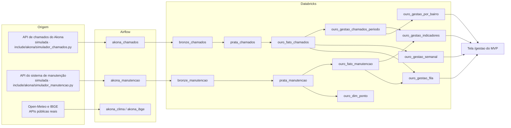

# Integração com o MVP web: tela "Painel da gestão"

O MVP do Akona Energy é um web app feito por outro integrante do grupo:
<https://ca-akona-energy-prod.salmoncoast-770d275b.eastus2.azurecontainerapps.io/gestao>.

Esta página mostra **toda a cadeia de dados da tela `/gestao`**: da origem dos dados, passando pelo Airflow e pelas
camadas Bronze, Prata e Ouro no Databricks, até as consultas da tela. A Ouro entrega os blocos da tela com os **mesmos
nomes de campo** do endpoint do MVP `/api/indicadores?dias=90`; as consultas estão em
[`databricks/consultas/consultas_gestao.sql`](../databricks/consultas/consultas_gestao.sql).

> O professor autorizou o uso de dados fictícios. Chamados e ordens de serviço são simulados; clima e IBGE são reais.

## O que a tela mostra e de onde vem

| Bloco da tela | Campos | View da Ouro | Vem de |
|---|---|---|---|
| Filtro "últimos 30 / 90 dias" | `dias` | todas as views têm a coluna `dias` (30 e 90) | – |
| Cartão **Chamados abertos** ("7 de 285 no período") | `abertos`, `total` | `ouro_gestao_indicadores` | chamados |
| Cartão **Tempo médio de reparo** | `tempo_medio_reparo_horas` | `ouro_gestao_indicadores` | chamados |
| Cartão **No prazo** (meta 85%) | `percentual_no_prazo` | `ouro_gestao_indicadores` | chamados + SLA de `dim_tipo_problema` |
| Cartão **Gap de equidade** (meta < 1,5) | `gap_equidade` = bairro mais lento ÷ cidade | `ouro_gestao_indicadores` | chamados |
| Cartão **Reincidência** (meta < 10%) | `percentual_reincidencia` | `ouro_gestao_indicadores` | **manutenção** (`fato_manutencao.reincidente_30d`) |
| **Fila de chamados não resolvidos** | protocolo, tipo, bairro, **ponto**, aberto em, status, ação | `ouro_gestao_fila` | chamados + **manutenção** (poste) |
| **Por bairro** | bairro, chamados, tempo médio, no prazo, barra | `ouro_gestao_por_bairro` | chamados |
| **Últimas 12 semanas** | semana, abertos, resolvidos | `ouro_gestao_semanal` | chamados |

Na fila, chamados de fio caído e queda de energia aparecem sem poste (`—`), porque são da distribuidora. Um chamado de
iluminação também pode aparecer sem poste quando a ordem de serviço dele foi barrada por uma regra de qualidade da
Prata (ex.: poste nulo ou fora do padrão). É o comportamento esperado: dado inválido não chega à Ouro.

**Conferido:** o JSON gerado pela Ouro (consulta 5 de `consultas_gestao.sql`) tem exatamente os mesmos campos do
`/api/indicadores` real do MVP, no nível de cima, em `por_bairro` e em `semanal`.

**O que não cobrimos**, porque não era necessário: os botões "Iniciar" e "Resolver" (no MVP eles mudariam o status
pelo próprio app; a view só informa qual ação mostrar) e a meta "−30% sobre a linha de base" do tempo de reparo.

## Linhagem: da origem até a tela

Orquestração: a `trigger-master` roda `akona_clima` ∥ `akona_ibge` → `akona_chamados` → **`akona_manutencao`**
(que depende dos chamados do dia) → `akona_ouro` → `akona_consultas`. A fonte nova entrou sozinha na `trigger-master`
porque está cadastrada em `config/fontes/manutencao.yaml` com `depende_de: [chamados]`.

## A fonte nova: ordens de serviço da manutenção

A tela tem duas informações que os chamados não têm: o **ponto** (o poste, ex.: `OSC-03024`) e a **reincidência**
(o mesmo poste com novo problema em até 30 dias). Na operação real, elas vêm do **sistema de manutenção da
iluminação pública** da prefeitura: cada chamado de iluminação gera uma **ordem de serviço (OS)** para a equipe, ligada
ao poste atendido. Esse sistema foi simulado seguindo o mesmo padrão das outras fontes.

| Peça | Arquivo |
|---|---|
| Cadastro da fonte (extrator, dependência, token, notebook da Prata) | [`config/fontes/manutencao.yaml`](../config/fontes/manutencao.yaml) |
| Chamada da API | `chamar_api_manutencao` em [`include/akona/apis.py`](../include/akona/apis.py) |
| Simulador da API | [`include/akona/simulador_manutencao.py`](../include/akona/simulador_manutencao.py) |
| DAG (2 linhas, padrão de fonte) | [`dags/akona_manutencao.py`](../dags/akona_manutencao.py) |
| Bronze | o notebook genérico [`bronze/bronze_autoloader.py`](../databricks/bronze/bronze_autoloader.py) (nada novo) |
| Prata (feita a partir do modelo) | [`databricks/prata/prata_manutencao.py`](../databricks/prata/prata_manutencao.py) |
| Ouro | [`ouro/dim_ponto.sql`](../databricks/ouro/dim_ponto.sql), [`ouro/fato_manutencao.sql`](../databricks/ouro/fato_manutencao.sql) e as views `ouro/gestao_*.sql` |
| Consultas do MVP | [`consultas/consultas_gestao.sql`](../databricks/consultas/consultas_gestao.sql) |

### Como os dados simulados são gerados
- **Ponto de partida:** o arquivo de chamados do dia (`chegada/chamados/chamados_AAAA-MM-DD.json`). Para cada chamado de
  **iluminação** (poste apagado ou lâmpada piscando, que são da prefeitura), existe uma ordem de serviço
  `OS-AAAAMMDD-TT-NNN`. Fio caído e queda de energia são da distribuidora e não geram OS.
- **Ciclo de vida igual ao do chamado:**
  - `aguardando_equipe` quando o chamado é aberto;
  - `em_execucao` quando a equipe começa;
  - `concluida` quando o chamado é resolvido, com o `tipo_servico` (troca de lâmpada, reator, fotocélula ou reparo
    de fiação).
- **Ponto (poste):** código `OSC-` + bairro (2 dígitos) + número (3 dígitos). Cada bairro tem 120 postes, e o poste é
  sorteado a partir do ID do chamado. Com isso, **cerca de 9%** das OS caem num poste que já teve OS nos 30 dias
  anteriores, perto dos 9,4% que a tela do MVP mostra. Cada poste tem tecnologia (LED ou vapor de sódio) e potência fixas.
- **Determinístico e sem efeito colateral:** o mesmo dia gera sempre o mesmo arquivo, e os sorteios usam sementes
  próprias. Os chamados e todos os números já existentes **não mudam**.
- **Sem dado pessoal:** as equipes são só códigos (`EQ-01` a `EQ-06`).
- **Sujeira proposital** para as regras da Prata:
  - poste nulo, que cai na **M1_obrigatorios**;
  - poste fora do padrão `OSC-NNNNN`, que cai na **M2_dominio**;
  - conclusão antes da abertura, que cai na **M3_datas_coerentes**;
  - status e bairro com variações de escrita, que a Prata normaliza.

### Como foi carregada
A carga inicial usou a DAG `akona_manutencao` no modo **`data_especifica`**, de 01/10/2026 a 17/11/2026 (o mesmo
período dos chamados), com lote `carga_inicial`. Depois, `akona_ouro` criou as tabelas e views, e `akona_consultas`
rodou as consultas da tela. No dia a dia, a `trigger-master` faz tudo sozinha.

## Como conferir
1. No Databricks, abra a execução mais recente de **"akona - consultas_gestao"** (Jobs & Pipelines → Runs). Ela mostra
   os 4 blocos da tela e, no fim, o **JSON no mesmo formato do `/api/indicadores`**.
2. Compare com <https://ca-akona-energy-prod.salmoncoast-770d275b.eastus2.azurecontainerapps.io/api/indicadores?dias=90>:
   os campos são os mesmos.
