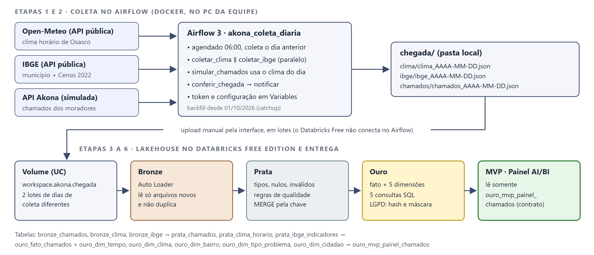

<!--
COMO USAR ESTE MODELO (apague este bloco antes de exportar)
- As seções seguem a ordem pedida no enunciado. Não mude a ordem (relatório fora da ordem perde até 1,0 ponto).
- Troque cada [PRINT: ...] pela imagem e mantenha a legenda "Figura N – ..." logo abaixo. Prints sem legenda ou ilegíveis também perdem pontos.
- Troque os valores entre colchetes [ ] pelos números reais das execuções de vocês.
- Para gerar o PDF: copie para o Word ou o Google Docs e exporte em PDF, ou use a extensão "Markdown PDF" do VS Code.
- Preencha nome completo e RM de TODOS os integrantes (faltar alguém custa 0,5 ponto).
-->

# Akona Energy · Componente de Dados do MVP

**Global Solution FIAP 2026.2 · CitizenTech**
**Disciplina:** Big Data Architecture & Data Integration · Engenharia de Software, 4º ano

**Repositório:** [https://github.com/GDPMg/akona-energy-dados](https://github.com/GDPMg/akona-energy-dados)

---

## 1. Integrantes

| Nome completo | RM |
|---|---|
| Guilherme Dal Posolo Matheus | 98694 |
| Lucas Laia Manentti | 97709 |
| João Lucas Yudi | 98458 |
| Guilherme Vargas | 98278 |
| Ryan Perez Pacheco | 98782 |

## 2. O produto e as perguntas que o MVP responde

**O produto em uma frase:** o Akona Energy é um webapp em que moradores de Osasco (SP) reportam problemas de
iluminação pública e de energia (poste apagado, lâmpada piscando, fio caído e queda de energia) para que a prefeitura e
a distribuidora acompanhem, priorizem e resolvam os chamados.

Este trabalho entrega o **componente de Dados** do MVP. A tela do MVP é um painel para a gestão que responde:

1. Quais bairros têm mais chamados abertos, e de que tipo?
2. Qual o tempo médio de resolução por tipo de problema e por bairro?
3. Quais chamados devem ser priorizados (fio caído e queda de energia primeiro)?
4. Chuva e vento aumentam os chamados de queda de energia?
5. **Impacto:** quantos moradores são afetados por problemas não resolvidos?

## 3. Diagrama do fluxo de dados, da fonte ao MVP



*Figura 1 – Fluxo de dados do Akona Energy: as fontes são coletadas pelo Airflow para a pasta chegada/, enviadas em lotes ao Volume do Databricks e tratadas nas camadas Bronze, Prata e Ouro até a tela do MVP, tudo orquestrado pelo Airflow.*

O Airflow roda em Docker no computador da equipe, com **uma DAG por processo**. Cada fonte tem a sua DAG
(`akona_clima`, `akona_ibge` e `akona_chamados`), que cobre o processo inteiro até a Prata: chama a API, grava o arquivo
do dia em `chegada/`, confere a chegada, envia o arquivo ao Volume `workspace.akona.chegada` (API de arquivos do
Databricks) e dispara os notebooks de Bronze e Prata, que rodam **no Databricks** (serverless). A DAG `akona_ouro` cria
as dimensões, a fato e a tabela do MVP, e a `akona_consultas` roda as análises. A **`trigger-master`** dispara todas na
ordem certa: clima e IBGE em paralelo, depois chamados (que usa o clima do dia), depois Ouro e consultas. O Auto Loader carrega a Bronze, a Prata trata e valida, a Ouro organiza em modelo
estrela e protege os dados pessoais, e o painel AI/BI lê só a tabela-contrato `ouro_mvp_painel_chamados`.

**Decisão de projeto:** o enunciado sugere enviar os arquivos ao Volume pela interface. Automatizamos esse envio com o
próprio Airflow porque o Databricks Free Edition aceita chamadas de API com token pessoal. O envio continua acontecendo
**em lotes de dias de coleta diferentes** (lote 1 e lote 2), mas é idempotente (arquivos já enviados são pulados) e
não depende de ninguém copiar arquivos ou colar código à mão.

## 4. Tabela de fontes

| Fonte | Origem | Formato | Frequência de coleta |
|---|---|---|---|
| Clima de Osasco (**externa**) | API pública Open-Meteo (`api.open-meteo.com/v1/forecast`), sem chave: chuva, vento, rajada, temperatura e código do tempo, por hora | JSON | diária, 06:00 (dia anterior) |
| Município e Censo 2022 (**externa**) | API pública do IBGE: localidades + agregados 4714 (população, área, densidade) e 4712 (domicílios e média de moradores por domicílio) | JSON | diária (dado de referência) |
| Chamados dos moradores (interna) | API do webapp Akona, **simulada** em Python porque o webapp ainda não existe. Exige token e usa dados pessoais fictícios | JSON Lines | diária, 06:00 (dia anterior) |

A ANEEL foi avaliada, mas o dataset de interrupções só é publicado como arquivos anuais nacionais de 265 a 424 MB,
com atualização mensal e sem API de consulta. Por isso ficou como trabalho futuro.

## 5. Requisitos 01 a 09

### Requisito 01 · Fontes de dados
Foram escolhidas duas fontes externas reais e uma interna simulada, todas ligadas ao problema. O **Open-Meteo** traz o
clima de Osasco, usado para medir se chuva e vento aumentam as quedas de energia. O **IBGE** traz a população e a média
de moradores por domicílio (2,78 no Censo 2022), usadas para estimar quantos moradores cada chamado afeta. Os
**chamados** vêm de um simulador que imita a API do webapp.

[PRINT: a pasta `amostras/` no GitHub ou um trecho de cada arquivo de amostra]
*Figura 2 – Amostras das três fontes no repositório.*

### Requisito 02 · DAG agendado gravando na pasta chegada/
A `trigger-master` está agendada para todo dia às 06:00 (`0 6 * * *`) e dispara as DAGs de fonte para coletar o dia
anterior (modo **incremental**). Cada DAG de fonte também aceita o parâmetro `modo`: `data_especifica` (período
`de` → `ate`, usado nos lotes 1 e 2 e para refazer um dia que não rodou) e `full` (de 01/10/2026, início do histórico
do projeto, até ontem). Em qualquer modo, o que já existe é pulado, então o full só preenche os dias que faltarem.
Não há um "full de verdade" (toda a história): os chamados do Akona começam em 01/10/2026 e a API de clima usada
guarda só os últimos ~3 meses. Por isso o full cobre **todo o histórico do projeto**, e a data inicial fica em
`config/projeto.yaml`.
A tarefa `coletar_api` de cada fonte grava **um arquivo por coleta, com a data no nome**
(`chegada/<fonte>/<fonte>_AAAA-MM-DD.json`, ex.: `clima_2026-10-05.json`). A coleta é idempotente: dia que já tem
arquivo não chama a API de novo. As URLs e os parâmetros de cada API ficam em `config/fontes/<fonte>.yaml`, e todas as
chamadas estão num único arquivo (`include/akona/apis.py`).

[PRINT: a pasta `chegada/` aberta no Explorer, mostrando os arquivos datados das três subpastas]
*Figura 3 – Arquivos gravados pelo DAG em chegada/, um por fonte e por dia de coleta.*

### Requisito 03 · Paralelismo, conferência da chegada e chaves fora do código
Na `trigger-master`, as DAGs `akona_clima` e `akona_ibge` rodam **em paralelo**; `akona_chamados` espera o clima,
porque usa a chuva do dia. Dentro de cada DAG de fonte, `coletar_api`, `preparar_databricks` e `publicar_notebooks` também
rodam em paralelo, e na `akona_ouro` as 5 dimensões são criadas ao mesmo tempo. A tarefa `conferir_chegada` verifica se
o arquivo de cada dia existe, não está vazio e é JSON válido; se faltar algum, ela falha e o `on_failure_callback`
dispara a notificação. No fim, a tarefa `notificar` da `trigger-master` registra o resumo (e envia ao Discord, se o
webhook estiver configurado). Os tokens (API de
chamados e Databricks) ficam em Variables (`akona_api_token`, `akona_databricks_token`), que o Airflow mascara na tela;
nada sensível aparece no código ou no repositório.

[PRINT: visão Gantt da trigger-master (lote_1), com akona_clima e akona_ibge lado a lado]
*Figura 4 – Gantt: as DAGs de clima e IBGE executando em paralelo.*

[PRINT: Admin → Variables com akona_api_token e akona_databricks_token mascaradas]
*Figura 4b – Variables do Airflow: tokens fora do código e mascarados.*

[PRINT: log da tarefa notificar da trigger-master mostrando a mensagem "trigger-master concluída"]
*Figura 5 – Notificação de sucesso registrada pela tarefa notificar.*

### Requisito 04 · Dois ou mais lotes enviados ao Volume
Os arquivos foram enviados ao Volume `workspace.akona.chegada` pela tarefa `enviar_ao_volume` de cada DAG de fonte
(API de arquivos do Databricks) em lotes de dias de coleta diferentes: **lote 1** com os dias de outubro (01/10 a 31/10,
**93 arquivos**: 31 por fonte) e **lote 2** com os dias de novembro (01/11 a 17/11, **51 arquivos**). Uma terceira
execução (**reexecucao**, 01/10 a 17/11) não enviou nenhum arquivo: os **144** já estavam no Volume. A partir daí, cada
coleta diária dispara o envio daquele dia.

[PRINT: log da tarefa enviar_ao_volume da akona_chamados no lote 2 mostrando "enviados" e "ja_existiam"]
*Figura 6 – Envio do lote 2 ao Volume pelo Airflow.*

[PRINT: Catalog → Volumes → chegada → chamados mostrando arquivos de outubro e novembro]
*Figura 6b – Volume com os arquivos dos dois lotes.*

### Requisito 05 · Bronze incremental e sem duplicação
O Auto Loader (`cloudFiles`, `trigger(availableNow=True)`) guarda no checkpoint quais arquivos já leu. No lote 2 só
entraram os arquivos novos, e rodar de novo sem arquivos novos não inseriu nenhuma linha. As contagens de cada
execução ficam em `controle_cargas_bronze` (detalhadas na seção 7).

[PRINT: execução "akona - bronze_chamados" no Databricks: tabela de contagens antes e depois]
*Figura 7 – Contagens da Bronze antes e depois de cada execução.*

### Requisito 06 · Prata: tratamento, MERGE e regras de qualidade
A Prata converte os tipos (`TIMESTAMP`, `DOUBLE`, `INT`) com `try_cast`/`try_to_timestamp`, normaliza tipo, status e
bairro (ex.: "Queda de energia" → `queda_energia`), aceita datas em dois formatos e preenche nulos (domicílios recebem a
mediana do tipo; canal vira `nao_informado`). Antes do `MERGE` pela chave `id_chamado`, os registros são deduplicados, e
o MERGE só atualiza um chamado quando o registro novo é mais recente: é assim que as mudanças de status do lote 2 entram.

| Regra | Barra quando | Barrados (de 1.426 registros) |
|---|---|---|
| R1_obrigatorios | id, tipo ou data de abertura nulo ou ilegível | 31 |
| R2_dominio | tipo ou status fora dos valores aceitos | 26 |
| R3_localizacao | bairro fora de Osasco ou GPS fora do município | 33 |
| R4_datas_coerentes | resolução anterior à abertura | 9 |

Ao todo, 99 registros foram para a quarentena `prata_chamados_rejeitados` e a Prata ficou com **614 chamados** válidos
(466 resolvidos, 107 em andamento e 41 abertos). No clima (1.152 horas) e no IBGE (288 leituras), as regras não barraram
nada, como esperado para dados oficiais; as 48 coletas do IBGE viraram só **6 indicadores** na Prata graças ao MERGE.

[PRINT: execução "akona - prata_chamados" no Databricks: total barrado por regra]
*Figura 8 – Total barrado por cada regra de qualidade.*

[PRINT: histórico do MERGE mostrando linhas inseridas e atualizadas no lote 2]
*Figura 9 – MERGE da Prata: o lote 1 inseriu 403 chamados; no lote 2, 211 foram inseridos e 45 atualizados (mudança de status); a reexecução não inseriu nem atualizou nada.*

### Requisito 07 · Ouro dimensional e 5 consultas
A Ouro é um modelo estrela com a fato `ouro_fato_chamados` (1 linha por chamado) e cinco dimensões: tempo, clima,
bairro (com dados do IBGE), tipo de problema e cidadão (pseudonimizado). As cinco consultas estão na seção 8.

[PRINT: diagrama do modelo estrela (README no GitHub) ou a lista de tabelas ouro_* no Catalog]
*Figura 10 – Modelo estrela da camada Ouro.*

### Requisito 08 · LGPD na Ouro e uso pelo MVP
Na Ouro o CPF vira `sha2(salt + cpf, 256)`. O salt fica no Databricks Secrets: foi gerado aleatoriamente pelo
Airflow, ninguém vê o valor e ele não está no repositório. Nome e
telefone ficam mascarados, e-mail e número da casa não entram e as coordenadas são arredondadas (~100 m). O MVP lê
**somente** a tabela `ouro_mvp_painel_chamados`, que é o contrato com o produto (a tela está na seção 9).

[PRINT: execução "akona - verificacao_lgpd" no Databricks: antes × depois (Prata × Ouro), com dados fictícios]
*Figura 11 – Dados pessoais na Prata (acesso restrito) e protegidos na Ouro (hash e máscara).*

### Requisito 09 · Repositório e README
O repositório público tem `dags/`, `databricks/`, `amostras/`, `docs/` e o `README.md` com integrantes, arquitetura e
o passo a passo para reproduzir. Não há chaves, senhas ou dados pessoais reais: `chegada/`, `.env` e certificados locais
estão no `.gitignore`, e as amostras usam dados fictícios.

[PRINT: página inicial do repositório no GitHub]
*Figura 12 – Repositório público com o README.*

## 6. Prints do Airflow

[PRINT: lista de DAGs do Airflow mostrando as 6 DAGs do projeto]
*Figura 13 – Uma DAG por processo: trigger-master, akona_clima, akona_ibge, akona_chamados, akona_ouro e akona_consultas.*

[PRINT: visão Graph da trigger-master]
*Figura 14 – trigger-master: akona_clima ∥ akona_ibge → akona_chamados → akona_ouro → akona_consultas → notificar.*

[PRINT: visão Grid da trigger-master com as execuções lote_1, lote_2 e reexecucao concluídas]
*Figura 14b – Execuções da trigger-master: lote 1, lote 2 e reexecução.*

[PRINT: visão Graph de uma DAG de fonte (ex.: akona_ibge)]
*Figura 14c – DAG de fonte: coletar_api → conferir_chegada → enviar_ao_volume → bronze → prata (preparar_databricks e publicar_notebooks em paralelo).*

[PRINT: visão Graph da akona_ouro]
*Figura 14e – DAG da Ouro: 5 dimensões em paralelo → fato_chamados → mvp_painel_chamados.*

[PRINT: Databricks → Jobs & Pipelines → Runs, com as execuções "akona - bronze/prata/ouro/consultas" disparadas pelo Airflow]
*Figura 14d – Execuções dos notebooks no Databricks, disparadas pelo Airflow.*

## 7. Contagens da Bronze antes e depois do 2º lote e da 2ª execução

| Execução | Fonte | Linhas antes | Linhas depois | Linhas novas | Arquivos depois |
|---|---|---|---|---|---|
| lote_1 | chamados | 0 | 917 | 917 | 31 |
| lote_2 | chamados | 917 | 1.426 | 509 | 48 |
| reexecucao | chamados | 1.426 | 1.426 | **0** | 48 |
| lote_1 | clima | 0 | 31 | 31 | 31 |
| lote_2 | clima | 31 | 48 | 17 | 48 |
| reexecucao | clima | 48 | 48 | **0** | 48 |
| lote_1 | ibge | 0 | 31 | 31 | 31 |
| lote_2 | ibge | 31 | 48 | 17 | 48 |
| reexecucao | ibge | 48 | 48 | **0** | 48 |

O lote 2 acrescentou só os 17 dias de novembro (509 linhas de chamados), e a 2ª execução sem arquivos novos manteve
as contagens: **a Bronze é incremental e não duplica**.

[PRINT: a mesma tabela na execução "akona - bronze_chamados" no Databricks]
*Figura 15 – Log controle_cargas_bronze com as três execuções.*

## 8. As 5 consultas SQL, com resultado e interpretação

O SQL completo está em `databricks/consultas/consultas_mvp.sql` (executado pela DAG `akona_consultas`).

### Consulta 1 · Quais bairros têm mais chamados abertos, e de que tipo?
```sql
SELECT b.bairro, COUNT(*) AS chamados_abertos,
       COUNT_IF(t.tipo_problema = 'fio_caido') AS fio_caido,
       COUNT_IF(t.tipo_problema = 'queda_energia') AS queda_energia,
       COUNT_IF(t.tipo_problema = 'poste_apagado') AS poste_apagado,
       COUNT_IF(t.tipo_problema = 'lampada_piscando') AS lampada_piscando,
       COUNT_IF(f.sla_vencido) AS com_sla_vencido
FROM workspace.akona.ouro_fato_chamados f
JOIN workspace.akona.ouro_dim_bairro b ON b.bairro_key = f.bairro_key
JOIN workspace.akona.ouro_dim_tipo_problema t ON t.tipo_key = f.tipo_key
WHERE f.status <> 'resolvido'
GROUP BY b.bairro
ORDER BY chamados_abertos DESC, com_sla_vencido DESC
LIMIT 10;
```
[PRINT: resultado]
*Figura 16 – Bairros com mais chamados abertos, por tipo.*

**Interpretação:** **Jardim das Flores** lidera com 19 chamados abertos, 17 deles de iluminação pública (11 postes
apagados e 6 lâmpadas piscando), ou seja, responsabilidade da **prefeitura**; 12 já passaram do SLA. Em seguida vêm
Santo Antônio (16), Presidente Altino (14) e Novo Osasco (13). Os bairros com mais backlog também estão entre os de
atendimento mais lento (consulta 2), então é ali que a prefeitura deve concentrar equipes de manutenção.

### Consulta 2 · Qual o tempo médio de resolução por tipo de problema e por bairro?
```sql
WITH resolvidos AS (
  SELECT t.tipo_descricao AS tipo_problema, b.bairro, f.tempo_resolucao_horas, f.sla_vencido, t.sla_horas
  FROM workspace.akona.ouro_fato_chamados f
  JOIN workspace.akona.ouro_dim_tipo_problema t ON t.tipo_key = f.tipo_key
  JOIN workspace.akona.ouro_dim_bairro b ON b.bairro_key = f.bairro_key
  WHERE f.status = 'resolvido'
),
agregado AS (
  SELECT tipo_problema,
         COALESCE(bairro, '(todos os bairros)') AS bairro_exibido,
         GROUPING(bairro) AS eh_total,
         COUNT(*) AS resolvidos,
         ROUND(AVG(tempo_resolucao_horas), 1) AS media_horas,
         ROUND(PERCENTILE(tempo_resolucao_horas, 0.5), 1) AS mediana_horas,
         MAX(sla_horas) AS sla_horas,
         ROUND(100 * AVG(CASE WHEN sla_vencido THEN 0 ELSE 1 END), 1) AS pct_dentro_sla
  FROM resolvidos
  GROUP BY GROUPING SETS ((tipo_problema), (tipo_problema, bairro))
)
SELECT tipo_problema, bairro_exibido AS bairro, resolvidos, media_horas, mediana_horas, sla_horas, pct_dentro_sla
FROM agregado
QUALIFY eh_total = 1 OR ROW_NUMBER() OVER (PARTITION BY tipo_problema, eh_total ORDER BY media_horas DESC) <= 3
ORDER BY tipo_problema, eh_total DESC, media_horas DESC;
```
[PRINT: resultado]
*Figura 17 – Tempo de resolução por tipo e os bairros mais lentos.*

**Interpretação:** os problemas da rede elétrica são resolvidos rápido: **fio caído em 6,3 h** em média (SLA 8 h,
72% no prazo) e **queda de energia em 15,6 h** (SLA 24 h, 85,5% no prazo). A iluminação pública é bem mais lenta:
**poste apagado leva 106,7 h** (4,4 dias; 64% no prazo) e **lâmpada piscando 163,8 h** (6,8 dias; só 55,6% no prazo).
**Jardim das Flores** é o bairro mais lento em três dos quatro tipos: lâmpada piscando em 233 h (1,4 vez a média do tipo
e só 33% no prazo), poste apagado em 151 h e queda de energia em 23,6 h, no limite do SLA.

### Consulta 3 · Quais chamados devem ser priorizados?
```sql
SELECT ROW_NUMBER() OVER (ORDER BY f.prioridade_score DESC, f.aberto_em) AS posicao,
       f.id_chamado, t.tipo_descricao AS tipo_problema, b.bairro, f.status,
       f.horas_em_aberto, t.sla_horas, f.sla_vencido, f.moradores_afetados_estimados, f.prioridade_score
FROM workspace.akona.ouro_fato_chamados f
JOIN workspace.akona.ouro_dim_tipo_problema t ON t.tipo_key = f.tipo_key
JOIN workspace.akona.ouro_dim_bairro b ON b.bairro_key = f.bairro_key
WHERE f.status <> 'resolvido'
ORDER BY posicao
LIMIT 15;
```
[PRINT: resultado]
*Figura 18 – Fila de prioridade (top 15).*

**Interpretação:** o score soma o peso do tipo (fio caído 100, queda 80, poste 40, lâmpada 20), até 30 pontos pela
espera, 20 se o SLA venceu e até 20 pelo número de moradores afetados. Por isso as **11 primeiras posições** são de fio
caído e queda de energia: no topo estão dois **fios caídos** (Rochdale e Ayrosa), risco de choque, abertos há semanas
com o SLA de 8 h vencido. Em seguida vêm quedas de energia que deixam muita gente sem luz, como a de Novo Osasco
(1.643 moradores afetados). O primeiro **poste apagado** só aparece na **posição 12** (Jardim das Flores, aberto há 783 h).
A fila dá à gestão uma ordem objetiva de atendimento.

### Consulta 4 · Chuva e vento aumentam os chamados de queda de energia?
```sql
WITH por_dia AS (
  SELECT c.data, c.condicao_clima, c.precipitacao_mm, c.rajada_max_kmh,
         COUNT_IF(t.tipo_problema = 'queda_energia') AS quedas_energia,
         COUNT_IF(t.categoria = 'Rede elétrica') AS chamados_rede_eletrica,
         COUNT_IF(t.categoria = 'Iluminação pública') AS chamados_iluminacao
  FROM workspace.akona.ouro_dim_clima c
  LEFT JOIN workspace.akona.ouro_fato_chamados f ON f.data_key = c.data_key
  LEFT JOIN workspace.akona.ouro_dim_tipo_problema t ON t.tipo_key = f.tipo_key
  GROUP BY c.data, c.condicao_clima, c.precipitacao_mm, c.rajada_max_kmh
)
SELECT condicao_clima, COUNT(*) AS dias,
       ROUND(AVG(precipitacao_mm), 1) AS chuva_media_mm,
       ROUND(AVG(rajada_max_kmh), 1) AS rajada_media_kmh,
       ROUND(AVG(quedas_energia), 2) AS quedas_energia_por_dia,
       ROUND(AVG(chamados_rede_eletrica), 2) AS rede_eletrica_por_dia,
       ROUND(AVG(chamados_iluminacao), 2) AS iluminacao_por_dia,
       (SELECT ROUND(corr(quedas_energia, precipitacao_mm), 2) FROM por_dia) AS correlacao_chuva_quedas,
       (SELECT ROUND(corr(quedas_energia, rajada_max_kmh), 2) FROM por_dia) AS correlacao_rajada_quedas
FROM por_dia
GROUP BY condicao_clima
ORDER BY quedas_energia_por_dia DESC;
```
[PRINT: resultado]
*Figura 19 – Chamados por dia conforme o clima.*

**Interpretação:** nos **7 dias de temporal** (chuva de 15 mm ou mais, ou rajada de 50 km/h ou mais) houve em média
**5,71 quedas de energia por dia**, contra 2,40 em dias de chuva fraca (30 dias) e **2,00 em dias secos** (11 dias):
quase **3 vezes mais** em temporal. Somando fio caído, a rede elétrica vai de 2,91 chamados por dia (seco) para 7,43
(temporal). A correlação das quedas com a chuva é **0,51** e com a rajada de vento é **0,63**: o vento pesa ainda mais.
A iluminação pública não acompanha essa escalada (6,7 a 9,7 por dia, sem relação com a chuva) e serve de controle.
**Resposta: sim.** *Observação:* os chamados
são simulados e o simulador usa o clima real do dia como fator de risco para a rede elétrica. A consulta mostra que o
pipeline captura essa relação; com os chamados reais do webapp, ela mediria o efeito verdadeiro.

### Consulta 5 (impacto) · Quantos moradores são afetados por problemas não resolvidos?
```sql
-- moradores afetados = domicílios afetados × média de moradores por domicílio (IBGE, Censo 2022)
WITH impacto AS (
  SELECT COALESCE(t.tipo_descricao, 'TOTAL') AS tipo_problema,
         COUNT(*) AS chamados_nao_resolvidos,
         SUM(f.domicilios_afetados) AS domicilios_afetados,
         SUM(f.moradores_afetados_estimados) AS moradores_afetados,
         ROUND(100.0 * SUM(f.moradores_afetados_estimados) / MAX(b.populacao_municipio), 2) AS pct_populacao_osasco,
         COUNT_IF(f.sla_vencido) AS com_sla_vencido
  FROM workspace.akona.ouro_fato_chamados f
  JOIN workspace.akona.ouro_dim_tipo_problema t ON t.tipo_key = f.tipo_key
  JOIN workspace.akona.ouro_dim_bairro b ON b.bairro_key = f.bairro_key
  WHERE f.status <> 'resolvido'
  GROUP BY ROLLUP (t.tipo_descricao)
)
SELECT * FROM impacto
ORDER BY tipo_problema = 'TOTAL', moradores_afetados DESC;
```
[PRINT: resultado]
*Figura 20 – Moradores afetados por problemas não resolvidos.*

**Interpretação:** hoje **12.345 moradores de Osasco** (1,69% da população de 728.615 habitantes do Censo 2022) estão
afetados por **148 chamados não resolvidos**, em 4.440 domicílios. Só **10 quedas de energia** respondem por **8.130
moradores** (66% do impacto), enquanto os 72 postes apagados afetam 2.755. Além disso, **101 dos 148 chamados já passaram
do SLA**. A mensagem para a gestão é clara: poucas quedas de energia concentram a maior parte do impacto e devem ser
resolvidas primeiro. *Limitação:* é uma estimativa, e dois chamados sobre a mesma queda podem contar as mesmas casas.

## 9. Tela do MVP consumindo a tabela da Ouro

A tela do MVP é um painel AI/BI do Databricks com indicadores (chamados não resolvidos, moradores afetados, % com SLA
vencido, tempo médio de resolução), o gráfico de não resolvidos por bairro e tipo, a fila de prioridade com o
solicitante mascarado e o gráfico de chamados da rede elétrica × chuva por dia. Todos os dados vêm de **uma única
tabela da Ouro**, `workspace.akona.ouro_mvp_painel_chamados`.

[PRINT: o painel publicado]
*Figura 21 – Tela do MVP: painel da gestão do Akona Energy.*

[PRINT: aba Data do painel mostrando o SQL com FROM workspace.akona.ouro_mvp_painel_chamados]
*Figura 22 – Os datasets do painel leem somente a tabela-contrato da Ouro.*

### 9.1 Integração com o MVP web: tela "Painel da gestão"

O web app do MVP, desenvolvido por outro integrante, tem a tela **Painel da gestão** (`/gestao`) com cartões de
indicadores, a fila de chamados não resolvidos, a tabela por bairro e as últimas 12 semanas. O pipeline tem toda a
cadeia que alimentaria essa tela. A integração é demonstrativa: o web app usa a própria base de demonstração.

- Quase tudo sai dos **chamados**, que já eram coletados: chamados abertos, tempo médio de reparo, % no prazo, gap de
  equidade (bairro mais lento ÷ cidade), tabela por bairro e semanas.
- O **poste** de cada chamado e a **reincidência** (mesmo poste em até 30 dias) vieram de uma **fonte nova, simulada**:
  as ordens de serviço do sistema de manutenção da iluminação pública. Ela foi incluída seguindo o padrão do projeto:
  `config/fontes/manutencao.yaml`, a DAG `akona_manutencao` (API → chegada → Volume → Bronze → Prata), a Prata
  `prata_manutencao` com 3 regras de qualidade, e `dim_ponto` + `fato_manutencao` na Ouro.
- Na Ouro, uma **view por bloco da tela** (`ouro_gestao_indicadores`, `ouro_gestao_fila`, `ouro_gestao_por_bairro` e
  `ouro_gestao_semanal`), com os mesmos nomes de campo do endpoint `/api/indicadores` do MVP e as janelas de 30 e 90 dias
  do filtro da tela.
- As consultas que o web app faria estão em `databricks/consultas/consultas_gestao.sql`. A última monta o **mesmo JSON**
  do endpoint do MVP. A linhagem completa está em `docs/mvp_gestao.md`.

[PRINT: a tela /gestao do MVP web]
*Figura 23 – Tela "Painel da gestão" do MVP web.*

[PRINT: execução "akona - consultas_gestao" no Databricks: cartões, fila com o poste, por bairro e semanas]
*Figura 24 – Os blocos da tela de gestão calculados pelas views da Ouro.*

[PRINT: o resultado da consulta 5 de consultas_gestao (JSON no formato do /api/indicadores)]
*Figura 25 – A Ouro entrega o mesmo contrato JSON que a tela do MVP consome.*

## 10. Conclusão técnica e link do repositório

O pipeline cobre o ciclo completo pedido, de ponta a ponta e sem passos manuais: coleta agendada no Airflow 3 com tarefas
paralelas, conferência da chegada, notificação e segredos em Variables; envio automático e idempotente dos lotes ao Volume;
execução de cada camada no Databricks disparada pelo Airflow; ingestão incremental com Auto Loader; uma Prata que trata
tipos e nulos, barra registros inválidos com regras contadas e usa MERGE para incorporar as mudanças de status dos
chamados; e uma Ouro dimensional que responde às perguntas do MVP e protege os dados pessoais com hash e máscara.

Decisões importantes: (1) o Airflow publica os notebooks do repositório antes de executá-los, então o código que roda no
Databricks é sempre o versionado no Git; (2) o simulador de chamados é determinístico e emite chamados novos e
atualizações, o que torna o MERGE realista e o reprocessamento seguro; (3) o MVP lê uma única tabela-contrato, o que
isola o produto das mudanças internas do modelo; (4) o salt do hash fica no Databricks Secrets, gerado automaticamente,
porque um hash de CPF sem salt é reversível por força bruta.

Limitações e próximos passos: substituir o simulador pela API real do webapp; incluir os dados de interrupções da ANEEL
para validar a consulta 4 com dados reais; processar a Prata de forma incremental (streaming com `foreachBatch`) quando o
volume crescer; e, fora do plano Free, trocar o Airflow local por um ambiente gerenciado.

**Repositório:** [https://github.com/GDPMg/akona-energy-dados](https://github.com/GDPMg/akona-energy-dados)
